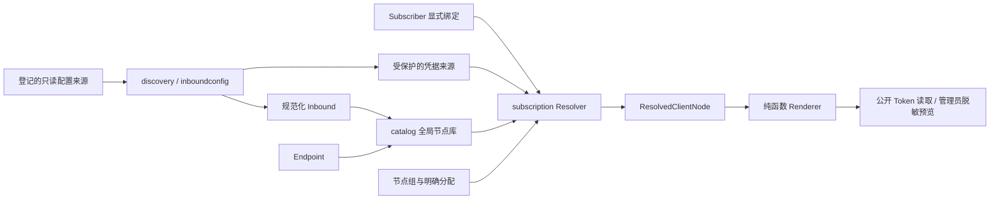

> 历史 v1 文档；不适用于 v2 安装或升级。

# Node Catalog & Subscription v1.0

## 模块及现有系统的复用

这是模块化单体中的增量模块，不增加服务、Docker 权限或核心运行时依赖。

复用 `servers`、`instances`、`users`、`identities`、配置路径限制、管理员认证/CSRF、原来的客户端输出函数及安全核心用户 CRUD。统计 `users` 是流量身份，不适合作为跨核心订阅授权主体，因此新增 `subscribers`，绑定仍引用已有核心 Client，并保存对应统计用户引用。

`internal/inboundconfig` 是从旧 discovery parser 移出的同一套协议规范化实现。`discovery` 负责来源读取/同步；`catalog` 负责节点、共享入口、分组及三态覆盖；`subscription` 负责授权、凭据解析及渲染；`httpapi` 只处理认证、HTTP 元数据和访问限流。Renderer 不读取数据库、文件、Docker 或核心 API。

## 迁移 014 与兼容边界

保留迁移 001–013，新增 `014_node_catalog.sql`，不改统计表、游标或归档算法。

新增表：`catalog_inbounds`、`node_endpoints`、`node_profiles`、`node_groups`、`node_group_members`、`subscribers`、`subscriber_credentials`、`credential_material`、`catalog_subscriptions`、`catalog_subscription_nodes`、`catalog_subscription_groups`、`subscription_access_logs`、`catalog_sync_runs`。

历史 `nodes` 的 UUID/密码从三个 JSON 列移到 `credential_material`。历史节点 ID、用户归属、旧订阅 Token 哈希、顺序、启用状态不变；兼容读取在授权后组合连接参数和凭据。旧节点连接参数还会导入全局节点库，并保留人工覆盖、TLS、ALPN 和入口；复制不会复制核心用户。新的节点定义及覆盖禁止保存认证参数。

与建议表名的差异：新订阅使用 `catalog_subscriptions`，原 `subscriptions` 专用于兼容旧地址。旧 bundle 明确授权多个不同用户的既有凭据，不能安全地自动推导为单一 Subscriber；自动转换会改变权限，因此保留兼容对象而不自动分配。新工作流统一使用 catalog 路由，旧用户可自行建立 Subscriber 后显式绑定并迁移分配。旧节点编辑不自动更新已独立维护的全局入口。

迁移不能在旧二进制上直接降级：旧代码不认识分离后的认证存储。回滚必须停止管理服务并恢复升级前数据库、Compose 与旧镜像的同一组备份；不要只换旧镜像。代理核心配置无需恢复，因为本模块不修改它们。升级前备份不可省略。

## 字段和来源

字段优先级：规范化 Inbound/手动来源 → Endpoint → Node 显式覆盖 → Subscriber 认证绑定。认证不参与普通覆盖。

覆盖保存 `{mode:"inherit"}`、`{mode:"set",value:...}`、`{mode:"clear"}`。Clear 删除上层字段，使用协议零值；空字符串 Set 与 Inherit 含义不同。后台参数来源页显示最终参数及来源，不返回真实认证。

连接定义的 ready 只表示字段完整。source_missing 表示原来源已移除；incomplete 表示连接字段不足；needs_review 表示手动来源或参数改变；disabled 表示对象停用；incompatible 表示已知扩展不支持。credential_missing 是 Subscriber 级状态，同一个全局 Node 对不同 Subscriber 可以有不同解析结果。

## 凭据与用户工作流

1. 登记实例和只读配置路径，同步入站及实际配置 Client。
2. 为 Node 选择 Inbound、Endpoint 和人工覆盖；同一 Inbound 可以创建/复制多个入口。
3. 新建 Subscriber，在“关联凭据”选择实际 Client。绑定按 Subscriber + Inbound 唯一，Client 标识包含实例及入站，不假定 email 全局唯一。
4. 给 Subscriber 创建订阅，显式选择节点和/或节点组，预览实际展开及过滤结果。
5. 缺少绑定、凭据来源被移除、绑定停用时跳过节点；不读取 Stats/Online 来猜测凭据。

已有受控宿主代理的 sing-box 用户 CRUD 仍从核心诊断页使用，保留配置哈希、校验、备份、二次确认重启及回滚流程。订阅模块不自动创建、删除或重启核心用户；其他核心尚未启用安全写入时不得伪装为支持。

手动节点可以登记单独的受保护认证来源，必须明确确认实际服务端已有此认证，然后再绑定到 Subscriber。这不会写入 Node，不会调用认证服务器，也不会自动创建核心用户。Hysteria2 HTTP/command 只发现入站元数据，不伪造可枚举的静态 Client；外部认证需管理员提供真实认证来源/手动节点。

Xray 明确的 runtime_api Client 移除会阻止相应订阅输出。新鲜的运行时凭据 HMAC 与绑定不一致时显示 needs_review；指纹不会返回 API。配置文件存在不证明运行中已生效，未取得独立证据始终显示 Unknown。订阅停用或取消节点授权不会撤销客户端已拿到的认证；真正撤销需核心管理流程。

## 同步

支持手动同步、只读差异预览和定时检测，默认 300 秒，可在订阅设置修改。配置哈希不变时跳过；变更时入站、凭据状态和兼容节点在同一 SQLite 事务更新。预览只返回数量、来源哈希和变更字段，不返回 UUID、密码或整个配置。

匹配结合实例、tag、协议及结构证据；唯一的结构指纹可处理 tag 改名。配置路径变化不改变实例内已识别的来源。参数变化标 needs_review；来源消失保留 Node。tag 改名且结构也改变、或多个来源结构相同的歧义不会擅自合并，需管理员重新选择来源和绑定。

登记的 JSON 文件或目录均在 `TML_CONFIG_ROOT` 内；目录按文件名合并 1–32 个 JSON 文件的 inbounds，总大小最多 4 MiB，不递归目录链接。HY 使用单个 YAML。普通文件缺失会标来源缺失；解析失败保留此前成功快照并记录失败审计。环境生成文件、多种 include/复杂加载方式需管理员提供当前有效的合并配置快照；TML 不推测它就是运行配置。

动态 API 创建但未持久化的凭据，若配置来源没有真实认证，显示缺失/需复核。运行 API 和配置资产独立保存；连接列表与流量用户不被当成完整配置用户列表。

## Renderer 与模板

唯一输入为 `ResolvedClientNode`。接口 `SubscriptionRenderer` 支持 Raw、Base64/v2rayN、Mihomo、sing-box。

- Mihomo 默认 full：proxies、select 策略组、本机 mixed-port、私网直连与默认 MATCH 规则，可导入 Clash Verge Rev。名称冲突自动消歧，所有组引用均存在。
- sing-box 默认 full：本机 mixed 入站、selector/direct 出站及最小路由；不修改系统代理。具体 GUI 是否支持订阅导入仍由客户端决定。
- collection 只输出 proxies/outbounds，供 provider/配置合并使用。
- 模板参数只有本机端口、选择组名称、默认路由等结构化字段，不执行代码或任意模板。真实协议节点生成继续复用现有输出逻辑。

兼容矩阵接口记录目标协议、传输、安全类型、Renderer、已验证客户端版本及跳过原因；验证版本不是对任意未来版本的保证。简单 VLESS/TLS/XHTTP URI 保留支持，Mihomo/sing-box XHTTP、复杂 extra/obfs/ECH/插件和未验证 AnyTLS 分享 URI 继续过滤。高级协议参数仅在经过官方客户端验证后扩展，不把不支持的组合包装为可用。

预览复制节点认证并替换为脱敏值，再经过同一个 Renderer；正式输出只有公开 Token 授权或管理员确认完整导出时包含真实认证。不得把 Base64 编码当成脱敏。

## 路由

沿用 `/api/v1`、管理员身份认证和会话 CSRF：

| 资源 | 路由及操作 |
|---|---|
| 全局节点 | GET/POST `/catalog/nodes`，GET/PATCH/DELETE `/catalog/nodes/{id}`，POST `/{id}/copy`、`/batch` |
| Endpoint | GET/POST `/catalog/endpoints`，PATCH/DELETE `/{id}`；共享更新要求 confirm_shared |
| 节点组 | GET/POST `/catalog/groups`，PATCH/DELETE `/{id}` |
| 入站及同步 | GET `/catalog/inbounds`、`/catalog/sync-history`，POST `/catalog/sync-preview`、`/discovery/scan`、`/catalog/inbounds/{id}/accept` |
| Subscriber | GET/POST `/catalog/subscribers`，PATCH/DELETE `/{id}` |
| 凭据 | GET `/catalog/credentials`（只有元数据），GET/POST `/catalog/bindings`，DELETE `/catalog/bindings/{id}`，POST `/catalog/manual-credentials` |
| 用户订阅 | GET/POST `/catalog/subscriptions`，GET/PATCH/DELETE `/{id}`，POST `/preview`、`/{id}/preview`、`/{id}/rotate-token`、`/{id}/export` |
| 元数据 | GET `/catalog/capabilities`、`/catalog/access-logs`，GET/PATCH `/catalog/settings` |

公开 `GET /sub/{token}` 使用保存的格式，可用 `?format=raw|base64|mihomo|singbox` 输出同一授权节点集。不能用查询参数读取任意配置文件或增加节点。旧 `/sub/{format}/{token}` 仍有效；旧 Mihomo 默认增加完整策略组，`?template=collection` 保留 provider 输出。

禁止保存启用但无可用节点的订阅；后续全部失效返回 422。错误 Token、禁用、到期和 Subscriber 停用拒绝读取。Token 32 字节安全随机，只保存 SHA256；创建/轮换返回明文一次，编辑不旋转。

新订阅访问日志只记录状态、时间、格式、已识别客户端 family/version 和 HMAC IP。IP 密钥每次启动随机，避免持久 IP 跟踪；不信任任意 X-Forwarded-For，因此 Nginx 后 RemoteAddr 可能共享限额。新旧公开路由均默认每来源每分钟 60 次，各最多维护 4096 个来源桶；旧订阅成功访问不写入新的 Subscriber 访问日志。Nginx 可另加按真实客户端地址的限流。

响应 private,no-store；提供 profile-title、profile-update-interval、content-disposition。没有可靠统一配额/完整计费流量时省略 subscription-userinfo。没有持久渲染缓存，每次授权后在数据库事务快照中解析，因此凭据/节点/分组/订阅变化不需要缓存失效补丁。

## 新适配器和验证

主要修改文件：`migrations/014_node_catalog.sql`；`internal/inboundconfig/{parser,sources}.go`；`internal/discovery/{parser,reconcile,sync}.go`；`internal/catalog/catalog.go`；`internal/subscription/{catalog_store,catalog_http,renderer,capabilities,store}.go`；`internal/httpapi/{catalog,catalog_public,api}.go`；`cmd/traffic-manager-lite/main.go`；`web/{catalog,app}.js`、`web/index.html`、`web/style.css`；各模块新增测试及 `scripts/e2e.cjs`。部署新增 `deploy/docker-compose.catalog.example.yml`，补充 Nginx 日志/限流示例；说明更新 README、本文及 verification/subscription-management。

新核心先扩展独立的配置读取/规范化，保留来源能力及 Unknown 运行证据，再复用 catalog。新 Renderer 实现接口，仅接收 ResolvedClientNode；加入明确的能力判定、脱敏预览和官方核心配置检查，不从核心 API 获取认证。

单元、API、历史迁移、浏览器流程及官方客户端检查覆盖：共享节点的不同认证、三态覆盖、复制、多入口、来源缺失、动态分组去重、Token/到期/停用、公开限流、全配置策略组、脱敏。浏览器只运行临时夹具数据库。另启动隔离 Mihomo 核心，验证 controller 的节点选择组真实存在，避免只做 YAML 语法检查。

## 3x-ui 借鉴与差异

参考官方 [Hosts](https://docs.sanaei.dev/docs/reference/api/hosts/)、[Subscription Server](https://docs.sanaei.dev/docs/reference/api/subscription-server/) 和 [订阅服务源码](https://github.com/MHSanaei/3x-ui/blob/main/internal/sub/service.go)，借鉴可复用入口、分组、独立订阅 ID 与多格式输出。没有复制其数据库或服务代码。

本模块独立支持外部核心/配置目录；Subscriber 不等同于核心 Client；Node 不持有认证；Renderer 不依赖核心；统计与授权分开；核心写入仍交给已有受控流程。运行证据、兼容限制和实际网络连通性分别展示，不用配置完整性冒充已验证连接。
