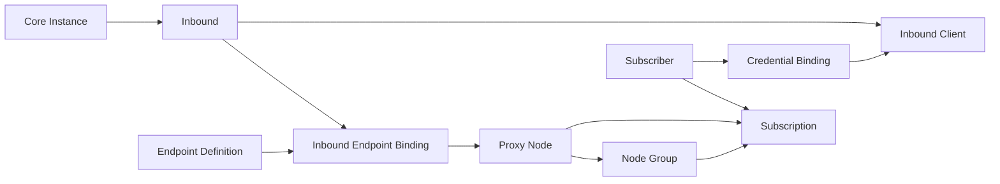

# Inbound-Centric Node & Endpoint Management v1.2

## 审计与最小改造

此前已具备独立 Subscriber、认证来源、稳定 Inbound Identity、共享 Endpoint、Proxy Node、Group 及 Resolver/Renderer。缺口是：Node 直接引用 Inbound/Endpoint，没有稳定绑定实体；创建入口只保存模板，不生成节点；节点编辑可以改变服务端归属；入站管理与连接入口操作分散；监听端口只展示单个整数，变化影响缺少独立记录。

复用原实体，新迁移017补充绑定、元数据与历史。没有重写订阅、采集、配置发现或宿主代理。数据关系为：



## 绑定与节点

`inbound_endpoint_bindings` 使用随机稳定 ID，唯一约束 `(inbound_id, endpoint_id)`。Tag、监听端口、地址和 SNI 不参与永久身份。每个绑定首次创建默认节点；重用模板绑定同一入站返回已有绑定与节点。Node 的 `(binding_id, variant_key)` 唯一，默认变体为 default，保留既有多变体和手动复制能力。

新增入口的 Endpoint、Binding、Node 和审计在同一 SQLite 事务内保存；参数错误或启用入口配置不完整则全部回滚。可选 request_id 提供重复请求幂等，同 key 的不同参数拒绝。模板本身允许未绑定；自动发现节点必须有稳定入站及一致绑定才能发布。显式手动节点继续按旧规则核对认证来源。

普通节点编辑不允许改变 Inbound ID，API 同样拒绝。需要迁移时使用明确的节点归属迁移：验证原节点修订、保留 Node ID/分组/订阅，改到目标稳定绑定并暂停发布；不迁移旧核心认证或流量。直接被旧订阅引用的节点不能普通删除或隐式合并，需先明确迁移分配。管理员核对局部覆盖和目标入站凭据后再显式启用。Tag 改名、入口地址变更不会改变绑定、Node、Group 或 Subscription ID。节点专属覆盖和旧合法变体继续保存，不能为了“一绑定一默认节点”删除既有资源。

覆盖顺序：Inbound 协议配置 → Endpoint Definition → Binding 局部三态覆盖 → Proxy Node 专属三态覆盖 → 授权后注入 Subscriber 凭据。inherit 使用前层值，set 设置当前层值，clear 移除字段。新表单默认把地址/端口/Host/SNI/ALPN/TLS等共有设置写入入口定义，把 Path、Mode、ServiceName 等局部设置写入绑定，避免复用模板时把 WS 路径强加到 XHTTP。

Endpoint CRUD 校验 IP/ASCII域名或Punycode、端口、Host/SNI、ALPN、已验证 XHTTP Mode；覆盖白名单拒绝 UUID、密码、私钥/API Secret。共享模板修改需要确认影响范围，列表及引用页显示绑定、节点、订阅归属。Node Group 仍只保存节点 ID，支持实例/服务器/入站/协议/入口类型筛选、批量选择和排序。入口类型是管理员分类，不冒充 Cloudflare 或网络探测结果。

## 状态与生命周期

Ready 表示连接字段完整，不证明凭据、客户端格式或网络可用。Network Status 默认 Unknown；不会探测、改动 Docker/Nginx、添加 Client 或重启核心。Renderer 继续在授权后按实际格式能力过滤，未知 XHTTP 扩展不会被原样导出。

| 变化 | 行为 |
|---|---|
| 唯一可信 Tag 改名 | 复用稳定入站、绑定和节点，保存历史别名 |
| 监听/协议参数改变 | 保留公网端口和覆盖，绑定标记 needs_validation，暂缓发布；记录变化依据 |
| 来源缺失/身份不确定 | 保留对象、分组和订阅；显示 Missing/Unresolved，不输出假节点 |
| 退役 | 只暂停 TML 发布，不停止核心；不物理删除历史。恢复需管理员显式取消退役 |
| 协议变更 | 先进入 pending；同实例候选、精确配置修订及管理员确认后可保留身份。暂停旧凭据绑定及关联旧版订阅交付、冻结既有计费用量，重新同步真实认证，再显式重新授权与确认映射 |

核对来源变更使用当前 config_hash；随后逐入口确认实际端口映射/代理转发。确认不等于自动网络验证。跨协议迁移拒绝存在托管 Desired 的入站，不能把旧托管 UUID/密码套到新协议，也不能自动重启核心。后续配置在确认之后又改变时，旧修订不再匹配。

Xray/V2Fly 监听端口支持官方数值、逗号分段和范围，不展开巨大范围。`env:` 保留核心侧引用，不读取 TML 宿主环境。sing-box/Hysteria2 保持各自实际监听语法，不虚构其端口范围能力。依据：[Xray 入站端口](https://xtls.github.io/config/inbound.html)、[sing-box Listen Fields](https://sing-box.sagernet.org/configuration/shared/listen/)。

## API 与后台

现有 `/api/v1/catalog/nodes`、`endpoints`、`groups`、`bindings`（用户凭据）等路由保留。新增管理员鉴权/CSRF接口：

| API | 用途 |
|---|---|
| GET catalog/inbound-management | 含服务器、客户端/入口/节点数量的入站列表 |
| GET catalog/inbounds/{id} | 入站详情及历史 Tag、配置版本、独立运行状态 |
| PATCH catalog/inbounds/{id} | 确认显示名称/退役；不写核心 |
| DELETE catalog/inbounds/{id} | 返回409，提示退役及保留引用 |
| GET catalog/inbounds/{id}/clients | 无认证内容的已有客户端元数据 |
| GET/POST catalog/inbounds/{id}/endpoints | 列出绑定；预选入站创建连接入口 |
| POST catalog/connections | 原子创建，支持 nested profile/overrides 或文档所示 camelCase 基本字段 |
| GET/PUT catalog/endpoint-bindings/{id} | 读/改局部覆盖与状态，乐观 revision；归属不能直接改变 |
| GET catalog/endpoint-bindings | 列出明确绑定供归属迁移选择 |
| POST catalog/nodes/{id}/move | 确认迁移节点归属、暂停发布、保留分组/订阅 |
| GET catalog/endpoint-bindings/{id}/history | 最近200条变化记录 |
| POST catalog/endpoint-bindings/{id}/copy | 复制独立入口及绑定，生成独立节点 |
| GET catalog/endpoints/{id}/references | 共享定义引用情况 |
| POST catalog/inbounds/{id}/ack-source | 精确修订的来源差异确认 |
| POST catalog/inbounds/{id}/protocol-transition | 确认待定跨协议逻辑身份，并暂停旧认证授权 |
| GET catalog/migration-preview | 只读旧节点关联报告，不执行合并 |

POST catalog/connections 示例：

```json
{"inboundId":"实际稳定入站ID","name":"CF优选","address":"cf.example.com","connectionPort":443,"host":"origin.example.com","sni":"origin.example.com","enabled":true}
```

返回 endpoint_id、binding_id、node_id、validation_status、network_status、binding_revision。不隐式新建 Inbound 或 Client。状态沿用内部旧名称 source_missing/needs_review，UI 映射为 Inbound Missing/Unresolved；needs_validation 独立显示。

后台“节点与订阅”增加入站管理、详情、搜索式入口选择、动态协议字段、实时节点预览、编辑/复制/引用、绑定变化记录、跨协议确认。PC、平板、手机沿用响应式布局。原节点库、旧订阅、托管用户与配置调和入口保留。

## 迁移、Dry Run 与恢复

迁移017不修改001–016，不改统计、配额、Token或授权。已有 Node 缺 Endpoint 时补一个空定义，保留原 Node 专属覆盖；已有同入站同模板多个节点仅共享绑定，使用 legacy:NodeID 变体，不自动合并。旧无法解析入站的资源保留为 unresolved；完整详情/格式预览仍需人工修复。

部署前备份一致 SQLite、源码、镜像、外层 .env 与 Compose。可把备份复制到临时目录，使用新镜像/二进制以临时数据库启动、离线迁移并导出 `catalog/migration-preview` 和重复候选报告；不挂生产数据可写卷，不连接生产核心。审核节点/绑定数量、旧ID/Token、覆盖、分组、订阅、凭据及统计事实，再升级生产。

在外层 `/data/traffic-manager-lite` 执行：

```sh
docker compose build traffic-manager-lite
docker compose up -d --no-deps traffic-manager-lite
```

仅更新管理服务。第一次启动事务应用017；再次启动不会重复生成绑定。检查健康、SQLite完整性、外键、旧地址和节点数量。不改变 Docker 端口映射、核心配置或 Nginx。小磁盘 VPS 可以先独立构建三个 Linux 二进制，再按项目 Dockerfile 运行阶段打包；应如实区分完整 Docker builder 与仅运行阶段验证。

恢复必须同时恢复迁移016的一致数据库、匹配旧镜像/源码；不得只删除017迁移记录。先停管理服务，再还原备份数据库，移除与之不匹配的临时 WAL/SHM（确认备份路径与服务已停止），恢复旧镜像并启动；代理核心不需要重启。017之后的管理员修改不会出现在旧备份中。

实际测试、现场备份及部署核验见 [verification.md](verification.md)。

## 文件清单与限制

迁移：017_inbound_endpoints.sql。Go：catalog/bindings及测试、catalog/catalog、endpoint_batch；inboundconfig/sources与ports测试、core/models；inboundidentity/identity及merge；httpapi/inbound_endpoints、protocol_transition及测试、catalog/api；subscription/catalog_store、quota、binding_usage及quota测试；storage/catalog_migration_test。前端：inbounds.js、catalog.js、index.html、style.css；scripts/e2e.cjs。文档：本说明、domain-glossary、README、AGENTS和verification。

本次不配置 NAT、Docker publish、Cloudflare 或 Nginx 转发，不代表全部协议真实连通。Unknown运行状态与部分统计仍保持真实限制；多个 Endpoint 不增加配额。Hysteria2/AnyTLS的未实现客户端扩展不伪造支持；认证仍从现有受控来源获得。存在托管 Desired 的跨协议迁移、冲突绑定合并及孤立历史对象需管理员独立处理，不自动破坏性修复。
